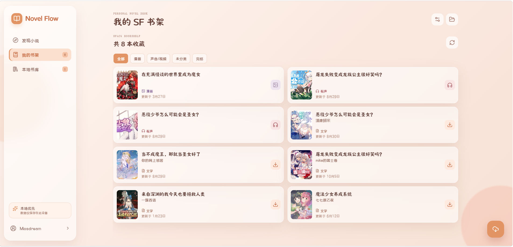
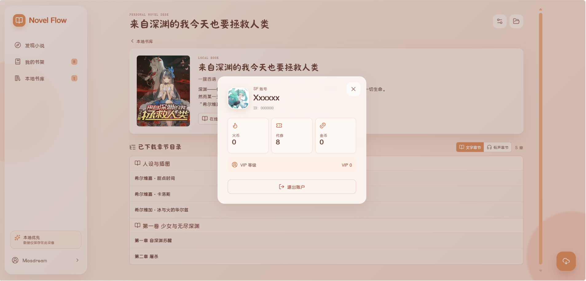
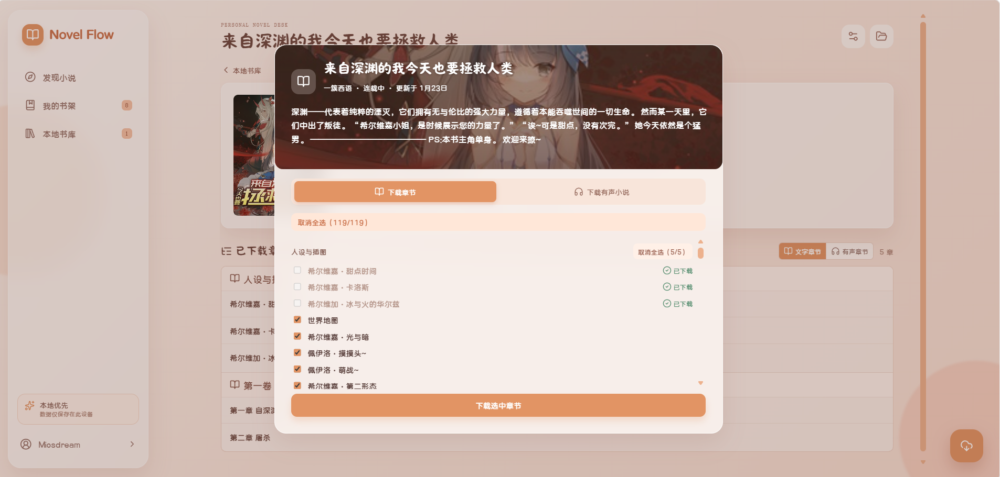
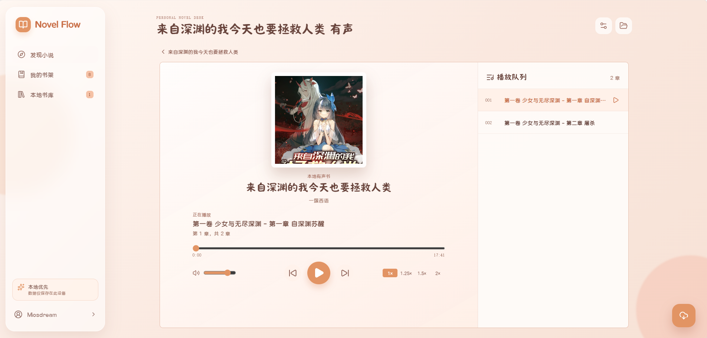

# 🍍 SF Novel Flow


<p align="center">
  <span>一个优雅的菠萝包轻小说平台的阅读与下载工作台</span>
  <br/>
  <span>基于 Tauri 2、Vue 3、Rust 和 TypeScript 构建的本地桌面应用</span>
</p>

<p align="center">
  <a href="https://tauri.app/"></a>
  <a href="https://vuejs.org/"></a>
  <a href="https://www.rust-lang.org/"></a>
  <a href="https://www.typescriptlang.org/"></a>
  <a href="./package.json"></a>
</p>

<p align="center">
  <a href="#-项目简介">项目简介</a> •
  <a href="#-核心特性">核心特性</a> •
  <a href="#-项目截图">项目截图</a> •
  <a href="#-快速开始">快速开始</a> •
  <a href="#-应用数据与配置">应用数据与配置</a> •
  <a href="#-项目结构">项目结构</a>
</p>

---

## 📋 项目简介

**SF Novel Flow** 是一个面向个人使用的菠萝包轻小说阅读工作台。它将在线搜索、账号书架、在线阅读、章节下载、本地阅读、有声播放和内容导出整合为一个跨平台桌面应用。

**软件支持 Windows 平台和 Android 平台。**

> [!IMPORTANT]
> App 凭证存在时，搜索、详情、文字目录、文字正文和有声地址优先使用 App 接口。缺少 App 会话时，文字正文和音频地址可回退网页接口。漫画目录与图片、网页书架只使用网页会话。两类凭证完全隔离。

> [!WARNING]
> 使用app凭证登录第三方客户端可能导致账号出现风控提醒，需要手动在手机端验证。使用本项目则表明理解使用风险，使用造成的后果自行承担。

## ✨ 核心特性

### 🔎 作品发现

- **作品搜索** - 按书名、作者或关键词搜索菠萝包轻小说作品
- **详情与目录** - 查看作品简介、作者、封面、分卷和章节状态
- **在线浏览** - 搜索结果卡片可进入详情，并直接在线阅读小说、漫画或收听有声章节
- **今日推荐** - 首页展示随机推荐封面，每次刷新都可能看到不同作品

### 🌐 在线阅读

- **无需预先下载** - 从详情页直接打开文字章节、漫画页面或有声章节
- **按需缓存** - 打开过的正文、漫画页和音频暂存于应用私有缓存，不写入本地书库
- **统一详情入口** - 搜索结果、远程书架和本地书库详情均可切换到在线阅读或在线收听
- **共用阅读器** - 在线内容复用本地小说、漫画和音频阅读器，切换数据源而不复制交互与样式

### 📥 章节下载

- **文字下载** - 按卷或按章节选择内容，保存为 Markdown 及本地章节数据
- **有声下载** - 获取有声目录，下载 MP3 并生成本地播放列表
- **断点续下** - 已下载章节会被标记；重启后的未完成任务会暂停，确认后可继续
- **下载队列** - 查看进度，暂停、恢复、取消或删除任务

### 📖 本地书库

- **本地阅读器** - 直接阅读已经保存的文字章节，不依赖在线章节接口
- **有声播放器** - 浏览本地音轨，切换章节并连续播放
- **作品详情** - 统一查看作者、简介、封面、文字章节和音频资源
- **多格式导出** - 文字可导出 EPUB、TXT、Markdown ZIP；有声内容可导出 ZIP

### 👤 账号与请求管理

- **双入口登录** - 支持账号密码连接 App，也支持在官方网页窗口完成登录
- **书架同步** - 查看、刷新已登录 SF 账号的个人书架，并按分类浏览
- **会话保护** - 密码不会传入前端或写入应用数据；Windows 会话以当前用户 DPAPI 保护后持久化
- **请求策略** - 自定义请求间隔和最大并发下载数

## 🎨 项目截图

<table>
  <tr>
    <td></td>
    <td></td>
  </tr>
  <tr>
    <td></td>
    <td></td>
  </tr>
  <tr>
    <td></td>
    <td></td>
  </tr>
  <tr>
    <td></td>
    <td></td>
  </tr>
</table>

## 🚀 快速开始

### 📦 环境要求

| 软件             | 版本                                                | 说明                         |
| ---------------- | --------------------------------------------------- | ---------------------------- |
| Node.js          | >= 18.17.0                                          | 安装前端依赖并运行 Tauri CLI |
| Rust             | stable                                              | 编译 Tauri 原生后端          |
| Windows 开发工具 | Visual Studio Build Tools（C++）和 WebView2 Runtime | Windows 桌面开发与运行所需   |

Android 开发还需要 Android Studio、Android SDK、JDK 和对应的 Tauri Android 环境配置。详见 [Tauri Android 前置要求](https://v2.tauri.app/start/prerequisites/#android)。

### OCR 识别模型

图片 VIP 正文识别需要 PP-OCRv6 小型识别模型。从 [ModelScope: PaddlePaddle/PP-OCRv6_small_rec_onnx](https://www.modelscope.cn/models/PaddlePaddle/PP-OCRv6_small_rec_onnx) 下载模型，将 ONNX 文件命名为 `PP-OCRv6_rec_small.onnx`，并放入 `src-tauri/resources/ocr-models/`。该目录被 Git 忽略，桌面与 Android 构建均会从此路径读取模型。

### 💻 从源码运行

1. **安装 JavaScript 依赖**

   ```bash
   npm install
   ```

2. **启动桌面开发模式**

   ```bash
   npm run tauri:dev
   ```

   Tauri 会启动 Vite 开发服务器并打开原生应用窗口。开发服务器仅用于热更新，不是对外 API 服务；无需在浏览器访问端口。运行前请按上方说明放置 OCR 模型。

3. **构建桌面安装包**

   ```bash
   npm run tauri:build
   ```

   构建产物位于 `src-tauri/target/release/bundle/` 下，具体格式取决于当前平台。
   该命令会构建并仅向桌面安装包加入 Python OCR worker；Android 不会携带该 Windows 可执行文件。

4. **启动 Android 开发构建（可选）**

   ```bash
   npm run tauri:android
   ```

   Android 发布构建使用 `npm run tauri:android:build`。OCR 识别模型已作为 Android assets 内置，运行时仅使用 ONNX Runtime Mobile。

   USB 真机调试时，如果手机无法访问开发机局域网或不需要走局域网，可使用 `adb reverse` 转发并配合 `--host 127.0.0.1`，详见 [Android 真机调试记录](./docs/ANDROID-DEVICE-DEBUGGING.md)。

## ⚙️ 应用数据与配置

书库、下载任务、请求策略、正文恢复字典和登录会话均由原生端保存在操作系统的应用数据目录中，而非项目根目录的 `config.json`。应用会自行创建和维护这些文件；请通过界面的请求设置与下载功能调整用户配置。

登录会话不会暴露给 Vue 渲染层。Windows 使用当前用户的 DPAPI 加密保存会话；退出登录会清除持久化会话。请勿手动分享应用数据目录中的文件。

## 📂 项目结构

```text
SF Novel Flow/
├── docs/
│   ├── image/                  # README 头图和界面截图
│   └── ANDROID-DEVICE-DEBUGGING.md # Android 真机调试记录
├── src/                        # Vue 3 渲染层
│   ├── components/             # 登录、章节选择、队列、导出和设置组件
│   ├── composables/            # 前端状态与 Tauri 命令调用
│   └── pages/                  # 搜索、书架、本地书库、阅读器和播放器
├── src-tauri/                  # Tauri 原生应用
│   ├── src/
│   │   ├── domain/             # 与框架无关的模型、规则和错误
│   │   ├── application/        # 用例服务、端口与进程状态
│   │   ├── adapters/           # SFACG、存储、下载、媒体、OCR 和平台实现
│   │   ├── commands/           # Tauri IPC 参数接收与用例调用
│   │   └── lib.rs              # 运行时、状态、插件、协议和命令装配
│   ├── capabilities/           # Tauri 权限配置
│   ├── icons/                  # 桌面与移动端图标
│   └── tauri.conf.json         # Tauri 构建与打包配置
├── vite.config.ts              # Tauri 开发模式使用的 Vite 配置
└── package.json                # 前端依赖与 Tauri 脚本
```

## 🎯 开发路线

### ✅ 已完成功能

- [x] 作品搜索、详情与文字目录
- [x] 原生官方登录与会话持久化
- [x] SF 书架同步与分类分页
- [x] 文字、有声下载和下载队列
- [x] 本地阅读器与有声播放器
- [x] EPUB、TXT、Markdown 和音频导出
- [x] 下载请求策略配置

### 🔄 预留模块

- [ ] 自动签到
- [ ] 更多内容类型与下载能力

## 📄 许可证

本项目采用 GPL3.0 License。项目仅供学习和研究，不得用于非法用途。

## 🙏 致谢

[LanBaiCode/auto-novel](https://github.com/LanBaiCode/auto-novel)：提供部分 API 接口。

[Oevani/Sfacg_Downloader](https://github.com/Oevani/Sfacg_Downloader)：提供部分 API 接口及签名方案。

---

<p align="center">
  Made for a quiet personal reading space · Novel Flow
</p>

<p align="center">
  <a href="#-novel-flow">⬆ 返回顶部</a>
</p>
